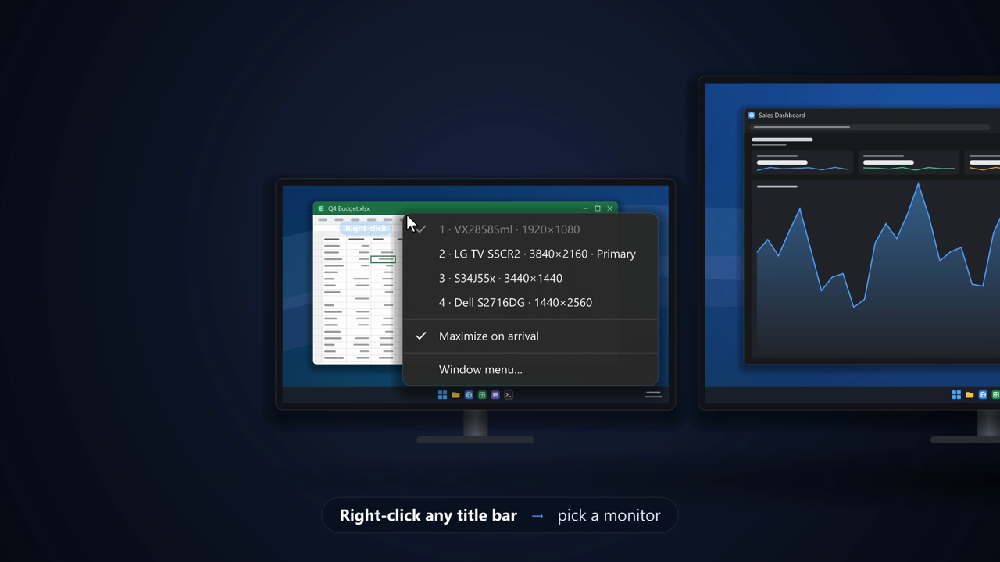

# SendToMonitor

A tiny Windows 11 tray utility: **right-click any window's title bar** and pick a monitor to send that window there, or **right-click empty space on a monitor's taskbar** and pick a window to bring to that monitor.

Handy on big multi-monitor setups, and when you're remoted into a multi-monitor PC from a single screen: bring windows from the monitors you can't see to the one you can.

[](docs/SendToMonitor-demo.mp4)

*Click the image for the 30-second demo (with sound).*

## Download

Get the latest version from [Releases](../../releases/latest). There's no installer: put the exe anywhere and run it.

| File | Use it if |
|---|---|
| `SendToMonitor-x64.zip` | You're not sure. Unzip and run `SendToMonitor.exe` on any 64-bit Windows 11 PC, no install needed. |
| `SendToMonitor-x64-requires-dotnet8.exe` | You already have the [.NET 8 Desktop Runtime](https://dotnet.microsoft.com/download/dotnet/8.0). Same app, much smaller download. |

Release exes are built by [GitHub Actions](.github/workflows/release.yml) from the tagged commit, never on a personal PC. Each release lists SHA-256 hashes, and you can check that an exe came from this repository's build with `gh attestation verify SendToMonitor.exe --repo brendenhudgins-cloud/SendToMonitor`.

Prefer not to run a downloaded exe? [Build it yourself](#build): it takes about a minute.

### Why does Windows or my antivirus warn about it?

- **SmartScreen ("Windows protected your PC")**: the exe isn't code-signed yet and new downloads have no reputation, so Windows warns about it. Choose *More info* → *Run anyway*, or build it from source (a build you make yourself doesn't trigger SmartScreen).
- **Antivirus detections**: SendToMonitor uses a low-level mouse hook (`WH_MOUSE_LL`) to see right-clicks on title bars and the taskbar. Keyloggers and click-hijackers use the same Windows API, so some scanners flag any unsigned program that does. The hook only looks at right-clicks, and only intercepts them on title bars and empty taskbar space; see [`MouseHook.cs`](MouseHook.cs). SendToMonitor makes no network connections and writes only its own `settings.json`, `log.txt` and (if you turn on *Start with Windows*) one registry value.

If your antivirus flags a release, please [open an issue](../../issues) with the product name and detection name so it can be reported as a false positive.

## Usage

Run `SendToMonitor.exe`. It sits in the notification area and does nothing until you right-click a title bar or an empty part of a taskbar.

### Title bar: send this window to another monitor

Right-click a title bar to get this menu:

```
✓ 1 · VX2858Sml · 1920×1080            (the monitor the window is on: checked, disabled)
  2 · LG TV SSCR2 · 3840×2160 · Primary
  3 · S34J55x · 3440×1440
  4 · Dell S2716DG · 1440×2560
  ─────────────
  Maximize on arrival
  ─────────────
  Window menu…                          (the window's normal Restore/Move/Size/…/Close menu)
```

- Monitors are numbered left-to-right, then top-to-bottom, and the list is rebuilt every time, so newly plugged-in displays show up. Press the number key to pick one from the keyboard.
- Monitors you've [named](#monitor-names) show your name instead of the model name, here and in the taskbar menu.
- **Shift + right-click** on a title bar shows the normal Windows title bar menu.
- Right-clicks anywhere else (page content, browser/terminal tabs, the desktop) behave as usual. The taskbar has its own menu, described next.
- With only one monitor connected, nothing is intercepted.
- Custom-drawn title bars (Chrome, Edge, VS Code, Windows Terminal, new Notepad) work wherever the app reports the spot as a draggable title bar, which usually means the empty space next to the tabs.

### Taskbar: bring a window to this monitor

Right-click **empty space** on any monitor's taskbar to list the open windows on your other monitors. Pick one and it moves to the monitor whose taskbar you clicked:

```
  Bring a window to 3 · Dell S2716DG     (the monitor whose taskbar you clicked)
  ─────────────
  On 2 · S34J55x
  [icon] Downloads - File Explorer
  [icon] Chat | Microsoft Teams
  ─────────────
  On 1 · VX2858Sml
  [icon] Inbox - Outlook
  [icon] Administrator: Windows PowerShell    administrator   (grayed: see below)
  ─────────────
  Maximize on arrival
  ─────────────
  Task Manager
  Taskbar settings                (the two items Windows normally shows here)
```

- Windows are grouped by the monitor they're on (minimized windows by the monitor they'll restore to), most recently used first. Windows already on this monitor aren't listed.
- It lists what Alt+Tab would show on the current virtual desktop: no dialogs, tool windows or hidden windows.
- The window lands the same way as from the title-bar menu (see below), is restored if it was minimized, and gets focus.
- Only empty taskbar space is taken over. App buttons keep their jump lists, and Start, Search, Task View, tray icons, the clock and Show Desktop keep their own menus. **Shift + right-click** on empty space gives the normal Windows menu.
- Turn this off with *Taskbar right-click menu* in the tray menu.

### Monitor names

To make monitors easier to tell apart, give them your own names: in the tray menu, choose **Monitor names** and pick a monitor. The naming dialog opens centred on that monitor, so you can see which one you're naming. The name replaces the model name in both the title bar and taskbar menus:

```
  1 · Left desk · 1920×1080
✓ 2 · Ultrawide · 3440×1440
  3 · Portrait · 1440×2560 · Primary
```

- Leave the name blank to go back to the model name.
- With **Show names on monitors** ticked in the tray menu (on by default), every SendToMonitor menu (title bar, taskbar, and the tray menu itself) also puts a label with the monitor's number and name in the middle of each monitor while it's open, like Windows' *Identify*. The labels are click-through, never take focus, and disappear when the menu closes.
- A name stays with the physical monitor: rearranging displays, changing resolution, rebooting, or unplugging and replugging it doesn't lose it. Windows treats a monitor plugged into a different port or dock as a new one, so name it again after moving the cable.
- Names are saved in `settings.json` under `MonitorNames`, keyed by the monitor's device path.

### Where the window lands

| Maximize on arrival | Result |
|---|---|
| **On** | Maximized on the target monitor, whether it started maximized, snapped, or windowed. |
| **Off** | Normal (restored) window on the target monitor, at the same relative spot in the work area (flush-right stays flush-right, centered stays centered). It keeps its size, shrinks proportionally if it doesn't fit, and is always fully visible. A maximized window is restored to its normal size on the target. |

Sizes are kept in *logical* units: going from a 150%-scaled monitor to a 100% one, a window keeps the same apparent size, the same as dragging it across. Windows that can't be resized or maximized (fixed-size dialogs) are only moved. The moved window keeps focus.

### Tray menu

- **Monitor names**: name a monitor (see [Monitor names](#monitor-names)).
- **Show names on monitors**: label each monitor with its number and name while a menu is open (on by default).
- **Maximize on arrival**: same toggle as in the title bar and taskbar menus.
- **Taskbar right-click menu**: turns the taskbar menu on or off (on by default).
- **Start with Windows**: adds or removes `HKCU\Software\Microsoft\Windows\CurrentVersion\Run\SendToMonitor`.
- **Pause**: stops intercepting right-clicks (the icon turns gray) until you un-pause.
- **Exit**

Settings are stored in `%APPDATA%\SendToMonitor\settings.json`. Errors, if any, go to `%APPDATA%\SendToMonitor\log.txt`.

## Elevated (administrator) windows

Windows blocks a normal program from inspecting or moving windows that run as administrator (UIPI). Task Manager, elevated terminals, installers and similar windows are left alone: you get their normal menu and no error. In the taskbar menu they're listed but grayed out, marked *administrator* (and a hung window is marked *not responding*).

To make SendToMonitor work on elevated windows too, **run it as administrator**: right-click the exe → *Run as administrator*. To always start it elevated at logon, use a Task Scheduler task with *Run with highest privileges* instead of the *Start with Windows* option, since the Run key can't start elevated programs.

## Build

Requires Git and the .NET 8 SDK (`winget install Git.Git Microsoft.DotNet.SDK.8`). Nothing else: no NuGet packages, no installer tooling.

```
git clone https://github.com/brendenhudgins-cloud/SendToMonitor.git
cd SendToMonitor
```

Single self-contained exe (no .NET install needed on the target PC), the same as the exe in `SendToMonitor-x64.zip` on the Releases page:

```
dotnet publish -c Release -r win-x64 --self-contained true -p:PublishSingleFile=true
```

Small exe for PCs with the .NET 8 Desktop Runtime, the same as `SendToMonitor-x64-requires-dotnet8.exe`:

```
dotnet publish -c Release -r win-x64 --self-contained false -p:PublishSingleFile=true
```

Output: `bin\Release\net8.0-windows\win-x64\publish\SendToMonitor.exe`. Copy it anywhere and run it.

For development, `dotnet build` / `dotnet run` work as usual. Every push and pull request is built by [CI](.github/workflows/ci.yml); pushing a `v*` tag runs the [release workflow](.github/workflows/release.yml).

## How it works

| File | Role |
|---|---|
| `MouseHook.cs` | `WH_MOUSE_LL` hook on the UI thread. Swallows a title-bar (or empty-taskbar) right-button-down **and** its matching up, then posts a message to a hidden owner window (the menu is never shown inside the hook). |
| `TaskbarProbe.cs`, `Uia.cs` | The Windows 11 taskbar is one XAML surface, so window hit-testing can't tell an app button from empty space. A background MTA thread asks UI Automation (`ElementFromPointBuildCache`, raw COM, no WPF) what's under the click: a `Pane`/`Group` is empty space, anything else (a `Button`, or an image inside one) is left alone. The hook waits for the answer on a kernel event (no message pumping) for at most 150 ms; it normally takes 2–5 ms, and on a timeout or failure the click passes through. |
| `WindowList.cs` | Alt+Tab-style window enumeration (visible, not cloaked, not tool/owned windows) and window icons converted to 32-bit alpha bitmaps for the menu. |
| `TitleBarDetector.cs` | `WindowFromPoint` + `WM_NCHITTEST` via `SendMessageTimeout` (`SMTO_ABORTIFHUNG`, 50 ms) on the window under the cursor, falling back to its `GA_ROOT` window when the child doesn't claim the point. Skips the desktop, taskbars, its own windows, and elevated processes. |
| `Monitors.cs` | `EnumDisplayMonitors`/`GetMonitorInfo` matched to EDID names from `QueryDisplayConfig` + `DisplayConfigGetDeviceInfo`. Falls back to "Display N". The same CCD query gives each monitor's device path, the stable key for its custom name. |
| `MonitorNameDialog.cs` | The "Name monitor N" dialog, opened centred on that monitor. |
| `MonitorLabels.cs` | The on-monitor labels: per-pixel-alpha layered windows (`UpdateLayeredWindow`) that are click-through (`WS_EX_TRANSPARENT`, `HTTRANSPARENT`), never activated (`WS_EX_NOACTIVATE`), drawn with GDI+ at each monitor's DPI, and shown just before the menu so the menu stays on top. |
| `WindowMover.cs` | Two-step move for mixed-DPI setups: put the window, restored, inside the target monitor, then apply the exact final rect (re-measuring the invisible borders at the new DPI) or maximize. Uses DWM extended frame bounds and work areas, and converts `rcNormalPosition` from workspace coordinates. |
| `TrayApp.cs` | Tray icon, hidden owner window, Win32 popup menus (`SetForegroundWindow` before / `WM_NULL` after `TrackPopupMenuEx`), and a watchdog that reinstalls the hook if Windows silently drops it. |

The app is Per-Monitor V2 DPI aware (`app.manifest`), so every coordinate is in physical pixels.

## Uninstall

Untick *Start with Windows*, exit from the tray, then delete the exe and `%APPDATA%\SendToMonitor`.

## License

[MIT](LICENSE). Provided as-is: it's built for and tested on Windows 11. Issues and pull requests are welcome, and are handled as time allows.
